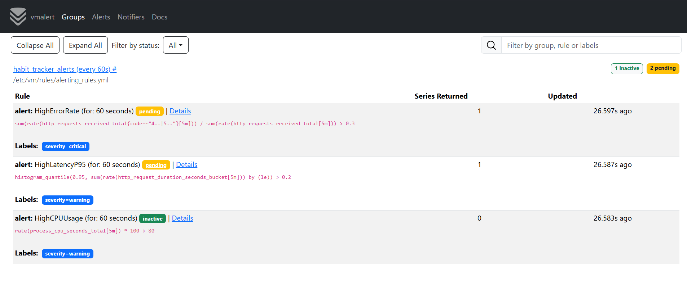
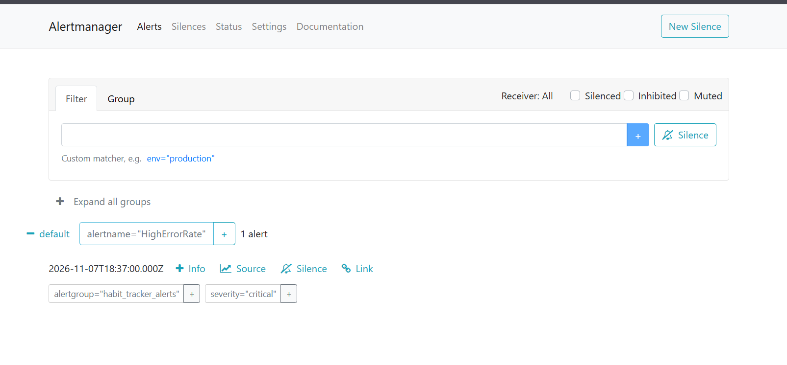

## Алерты

Развёрнуто в Kubernetes (namespace metrics) Helm-чартами:

* victoria-metrics-single (vmsingle)
* victoria-metrics-alert (vmalert + встроенный Alertmanager, включён флагом alertmanager.enabled: true)

### Правила алертинга (alerting_rules.yml)

HighErrorRate - доля 4xx/5xx > 30% за 5 мин	1m critical
HighLatencyP95 - p95 > 200 мс 1m warning
HighCPUUsage - process_cpu_seconds_total > 80% CPU за 5 мин	1m warning

Обоснование выбора:
* HighErrorRate — прямой индикатор деградации API; порог 30% и окно 5 минут отсекают единичные ошибки, for: 1m защищает от ложных срабатываний.
* HighLatencyP95 — p95 отражает опыт «медленных» пользователей лучше среднего; 200 мс — ожидаемое время ответа API, превышение сигнализирует о проблемах с БД/нагрузкой.
* HighCPUUsage — метрика рантайма процесса; >80% в течение минуты указывает на перегрузку или утечку ресурсов.

Алерты покрывают требования: 2 алерта на метрики сервиса (HighErrorRate, HighLatencyP95) и 1 алерт на метрики рантайма (HighCPUUsage).

### Артефакты

В UI vmalert (/vmalert/, вкладка Alerts) правила загружены и отображаются:

Сработавший алерт (закинула 10-15 запросов 400, чтоб тригернуло): 

