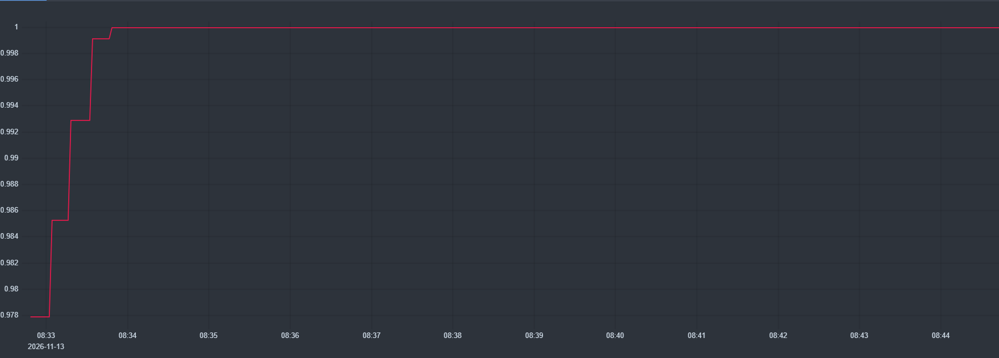
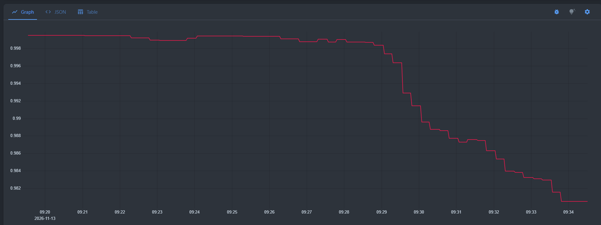
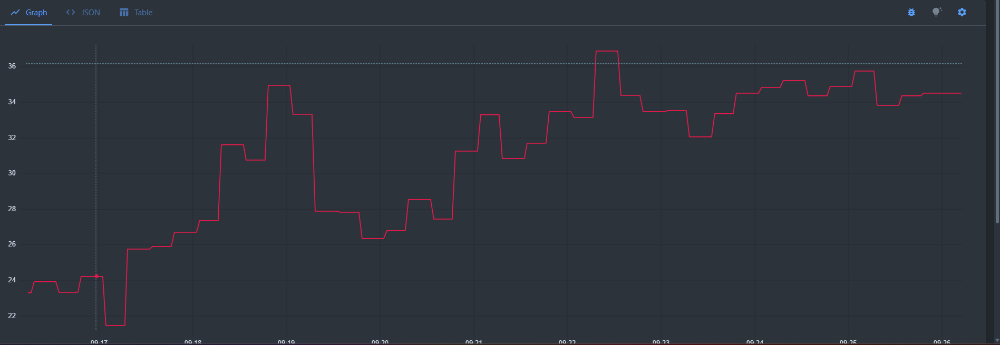

### 1. Доступность API

* Что измеряет: доля успешных HTTP-запросов к бизнес-эндпоинтам среди всех запросов к ним. Покрывает все бизнес-операции
* Формула
```
sum(rate(http_requests_received_total{endpoint=~"api/Habits.*",code=~"2..|3.."}[5m]))
/
sum(rate(http_requests_received_total{endpoint=~"api/Habits.*"}[5m]))
```
* График



* SLO: 97.5% успешных запросов за 30 дней
* SLA: 97% успешных запросов за 30 дней

### 2. Задержка ответа API

* Что измеряет: доля HTTP-запросов к бизнес-эндпоинтам, выполненных быстрее 256 мс (latency budget).
* Формула
```
sum(rate(http_request_duration_seconds_bucket{endpoint=~"api/Habits.*",le="0.256"}[5m]))
/
sum(rate(http_request_duration_seconds_count{endpoint=~"api/Habits.*"}[5m]))
```
* График



* SLO: 98.5% запросов быстрее 512 мс за 30 дней
* SLA: 97% запросов быстрее 512 мс за 30 дней


### 3. CPU Saturation
* Что измеряет: доля процессорного времени, которое приложение тратит на обработку запросов. Показывает, насколько сервис близок к перегрузке.

Формула:
```
system_runtime_cpu_usage
```

* График



* SLO: не более 40% использования CPU в течение 5 минут
* SLA: не более 80% использования CPU в течение 5 минут

### Пробер
Для того чтобы метрики отражали реальную картину под нагрузкой, в кластере был развернут генератор трафика k6. 
Он эмулирует действия пользователя: создает привычки и запрашивает их список

### Скринкаст
Видео поделено на 2 части, в первой я имитирую падение бд, а во второй показываю метрики через 5 минут
