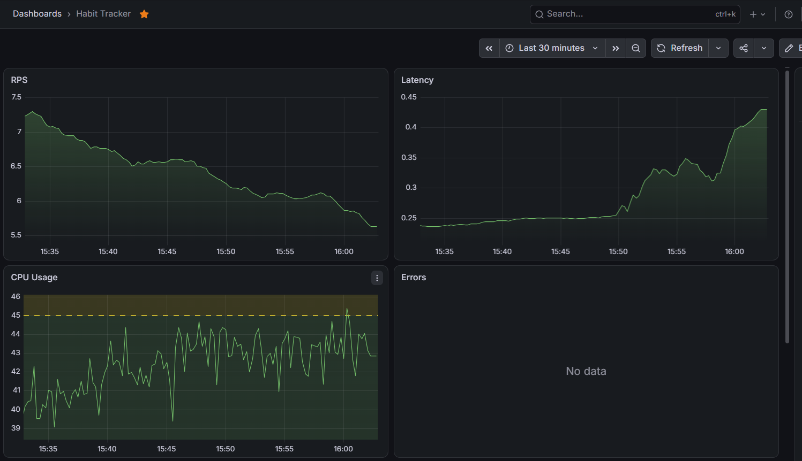
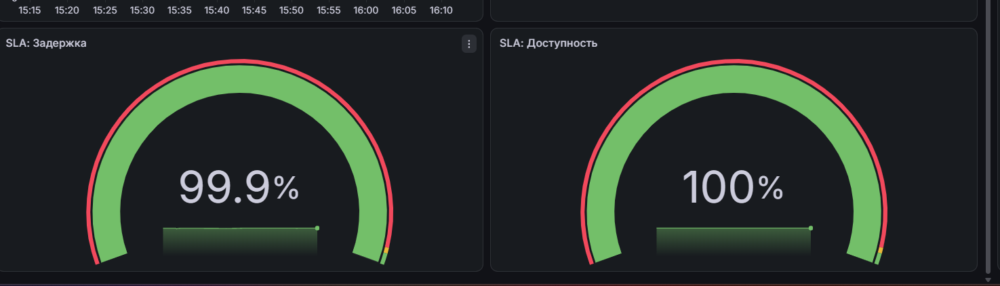
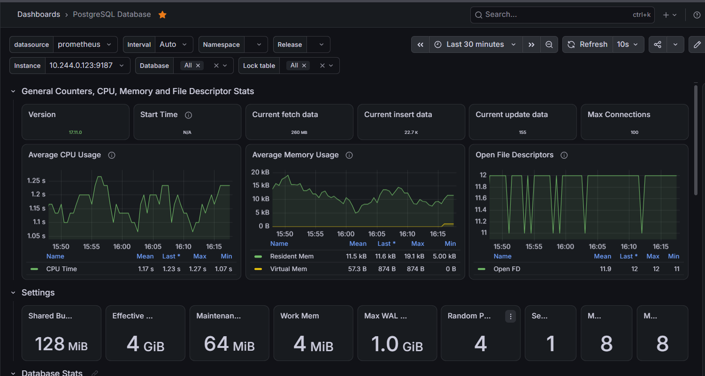

### Верхний ряд дашборда отображает «золотые сигналы» — ключевые показатели состояния сервиса:

* Traffic (RPS): Показывает, сколько запросов в секунду обрабатывает API
* Errors: График количества серверных ошибок (HTTP 5xx). При штатной работе линия находится на нуле
* Latency (P95): График 95-го перцентиля времени ответа. Показывает, за какое время отвечает сервис для 95% запросов
* Saturation (CPU): График system_runtime_cpu_usage. Показывает потребление процессора. Настроена цветовая индикация: зеленая зона (до 46%), желтая (46–80%) и красная (выше 80%).

### SLA-спидометры (Gauge) для пробера

В отдельный блок вынесены две панели типа Gauge, которые считают выполнение SLA в реальном времени на основе данных от пробера (k6):

* SLA: Доступность
Доля успешных запросов. Настроены пороги: зеленая зона (> 98%), желтая (97-98%), красная (< 97%).
* SLA: Задержка
Доля запросов, уложившихся в бюджет 512 мс (в процентах). Зеленая зона (> 98%).

### Дашборд PostgreSQL Exporter

Отдельно импортирован готовый дашборд для postgres-exporter (ID 9628):

